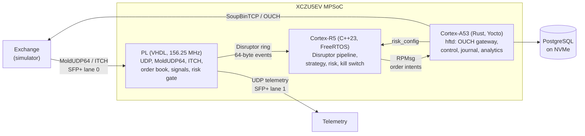
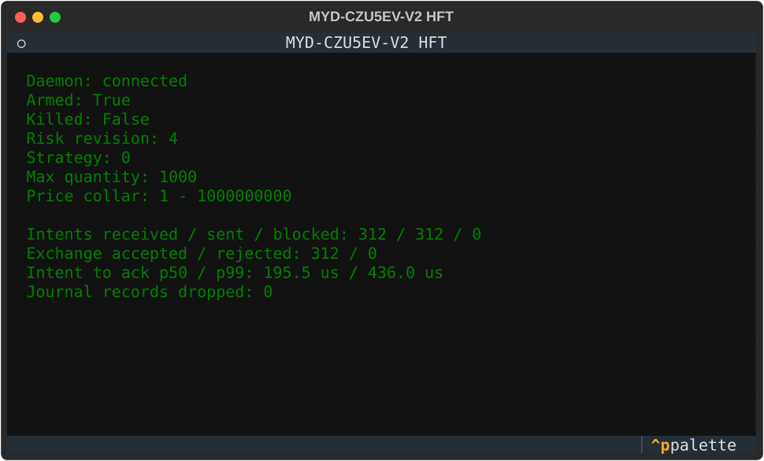
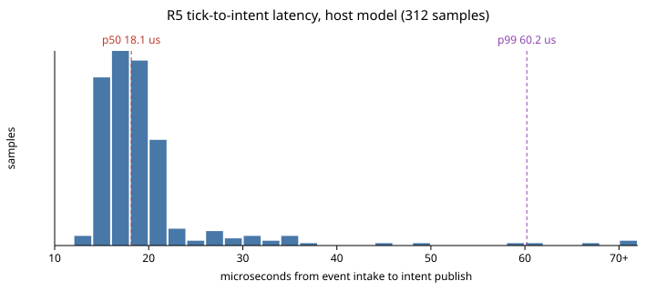

# MYD-CZU5EV-V2 HFT reference design

[](https://github.com/ps-chong/hft-toy-project/actions/workflows/fpga.yml)
[](https://github.com/ps-chong/hft-toy-project/actions/workflows/r5.yml)
[](https://github.com/ps-chong/hft-toy-project/actions/workflows/a53.yml)
[](https://github.com/ps-chong/hft-toy-project/actions/workflows/quality.yml)
[](https://github.com/ps-chong/hft-toy-project/actions/workflows/demo.yml)
[](https://github.com/ps-chong/hft-toy-project/actions/workflows/swupdate.yml)

An educational, end-to-end trading system for the MYIR MYD-CZU5EV-V2 board
(AMD Zynq UltraScale+ XCZU5EV MPSoC). Market data enters the FPGA fabric over
10G Ethernet, the Cortex-R5 decides and applies risk, and the Cortex-A53
Linux side talks to the exchange. Every layer is fail-closed, every shared
byte layout is generated from one schema, and the whole system runs on one
workstation through a Docker Compose demo.

It is not a production trading system, and nothing here deploys to
hardware.



## Highlights

- **PL:** a 64-bit, one-beat-per-cycle VHDL-2008 pipeline. Its MoldUDP64
  parser splits messages at any byte lane in one cycle. The order store is
  two-way set-associative in UltraRAM, and a bitmap priority encoder finds
  the top of book. Strategies are evaluated in parallel, and a fault-dominant
  kill latch gates entries. Configuration and status cross between the two
  clock domains only through a handshake snapshot, and Vivado's CDC report
  gates the build.
- **R5:** an LMAX Disruptor ring with a compile-time Boost.MP11 stage
  pipeline, branch-free risk rules, `std::variant` strategies,
  `std::expected`, and a sticky epoch-based kill switch. Configuration
  arrives through a wait-free triple buffer, and the control actor is a
  coroutine with its frame in a fixed arena. There are no locks, no heap
  allocation, and no globals on the trading path.
- **A53:** Tokio actors around an in-house `forbid(unsafe)` Disruptor
  crate, model-checked with `loom`. The OUCH gateway is the gating consumer,
  and the PostgreSQL journal and analytics are lossy consumers.
- **Contracts:** one schema generates C++, Rust and VHDL layouts with
  compile-time offset checks, plus golden vectors used by every layer.
- **Equivalence:** a datagram capture replayed through the RTL must produce,
  byte for byte, the same events as the Rust software model of the PL.
- **Yocto:** an A/B image with signed SWUpdate bundles, NVMe data storage,
  and ONNX Runtime (CPU provider) for noncritical analytics.

## The demo

```bash
demo/run_demo.sh --smoke        # Linux or WSL; the Windows wrapper is scripts\windows\demo.ps1
```

The demo builds everything and starts the exchange simulator, the PL
software model, the real R5 firmware core, `hftd` and PostgreSQL. It then
walks through five steps:
- a fail-closed start;
- arming;
- an injected feed gap that the R5 latches as a kill;
- re-arming;
- an operator kill.

Finally it replays the captured feed through the VHDL and checks that the
RTL matches the software model. See
[docs/workflow/06-demo.md](docs/workflow/06-demo.md).



## One packet, measured

In RTL simulation, an add-order frame reaches the R5 event port 17 cycles
(109 ns) after its first beat on the wire:


| Segment | Value | Source |
| --- | --- | --- |
| PL: first frame beat to R5 event port | 17 cycles, 109 ns | RTL simulation (checked by a test) |
| PL: last frame beat to R5 event port | 5 cycles, 32 ns | RTL simulation |
| R5 model on a host: event to intent, p50 / p99 | 18 us / 60 us | demo |
| A53 on a host: intent to exchange ack, p50 / p99 | 195 us / 436 us | demo, through Docker networking |
| Vivado: setup slack at 156.25 MHz | +0.906 ns | out-of-context synthesis, XCZU5EV-2 |
| Vivado: routed setup / hold slack | +0.296 ns / +0.010 ns | out-of-context implementation, XCZU5EV-2 |

Host numbers show that the software paths work; they are not board
measurements. See [docs/latency.md](docs/latency.md).



## Getting started

| Step | Guide |
| --- | --- |
| Tools, WSL, container image, Vivado license tier | [01 Setup](docs/workflow/01-setup.md) |
| Schemas and generated code | [02 Contracts](docs/workflow/02-contracts.md) |
| RTL, simulation, Vivado | [03 FPGA](docs/workflow/03-fpga.md) |
| R5 firmware | [04 Cortex-R5](docs/workflow/04-r5.md) |
| Rust services | [05 Cortex-A53](docs/workflow/05-a53.md) |
| The demo | [06 Demo](docs/workflow/06-demo.md) |
| CI, locally and on GitHub | [07 CI](docs/workflow/07-ci.md) |
| Yocto image and updates | [08 Yocto and release](docs/workflow/08-yocto-release.md) |
| One add order through every layer | [09 Life of a packet](docs/workflow/09-packet-walkthrough.md) |

The shortest path to running every check locally, from a clone in WSL with
Docker:

```bash
scripts/ci/local.sh all
scripts/linux/build-fpga.sh --profile sim-dma --goal impl   # the Windows Vivado, through WSL interop
scripts/linux/xsim.sh                                       # the VUnit benches on the Vivado simulator
```

From a Windows checkout, `scripts/ci/sync-wsl.sh` mirrors it into WSL first,
and the PowerShell wrappers run Vivado directly:

```powershell
.\scripts\windows\build-fpga.ps1 -Profile sim-dma -License "$env:APPDATA\XilinxLicense-BASIC"
```

## Repository map

| Path | Contents |
| --- | --- |
| `protocol/` | Schemas, the generator, generated C++/Rust/VHDL, golden vectors |
| `zynq/ultrascale+/` | RTL, VUnit testbenches, constraints, Vivado Tcl, board files |
| `cortex/r5/` | R5 firmware core, platform C ABI, host model (`hft_r5_sim`) |
| `cortex/a53/` | Rust workspace: `hftd`, `hftctl`, Disruptor, protocol, RPMsg, OUCH, storage, PL model |
| `tests/cpp/` | GoogleTest suites for the R5 core |
| `python/` | Exchange simulator, dashboard, replay comparer, latency and debug tools |
| `demo/` | The Compose demo script |
| `containers/` | Host and Yocto build images, the Compose file |
| `yocto/` | `meta-hft`: machine, A/B image, OpenAMP, NVMe, SWUpdate, ONNX Runtime |
| `deploy/swupdate/` | Bundle description and builder |
| `scripts/` | CI helpers; Linux/WSL and Windows wrappers (Vivado, xsim, runner, CI polling); figures |
| `docs/` | Architecture, workflow guides, figures, generated register map |

## Status

The board-level pieces stay deliberately unfinished: the MAC/PCS
integration, the MYIR PS/DDR preset, the physical SFP cage mapping, and
measured on-board latency. Bitstream and XSA generation therefore fail
closed. The architecture documents are indexed in
[docs/architecture/README.md](docs/architecture/README.md), and the operating
limits are in [docs/safety.md](docs/safety.md).
