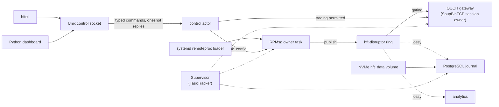
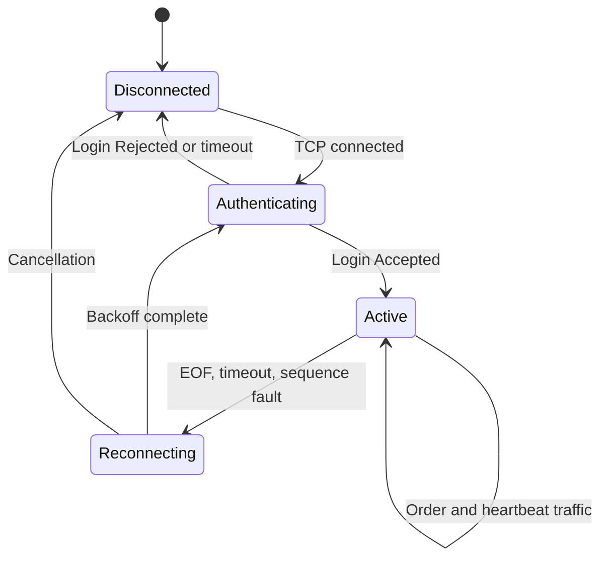

# Cortex-A53 Linux architecture

## Actor graph

Each socket, session and mutable state machine has exactly one owner task.
The RPMsg owner is the single producer of an in-house Disruptor ring
(`hft-disruptor`, `forbid(unsafe_code)`): the OUCH gateway is its only gating
consumer, so no intent is ever dropped, while the storage journal and
analytics are lossy consumers that detect and count being lapped, so a slow
database can never back up order flow. The order path has no
`Arc<Mutex<_>>`. The supervisor spawns every task through one
`TaskTracker`; SIGINT and SIGTERM cancel them and drain the journal before
exit.

## RPMsg lifecycle

The remoteproc unit loads `/lib/firmware/hft-r5.elf`, starts R5-0, and waits for
the RPMsg endpoint. `hftd` opens the character endpoint with one RAII owner.
Every 64-byte record is decoded field-by-field and checked for ABI version.
Kernel reset, EOF, short record, or ABI mismatch ends the actor and leaves
systemd restart policy in control.

## OUCH state machine

The first implementation covers login, heartbeats, Enter/Replace/Cancel
encoding, and accepted/rejected lifecycle framing against the simulator. Live
credentials are not supported by defaults and are never logged.

## Observability

Rust `tracing` fields include session ID, source sequence, user reference,
symbol, risk revision, component, and latency domain. On Yocto, records go to
`systemd-journald`; on a developer host they fall back to formatted stderr.
R5 CIB records are forwarded and re-emitted under the `hftd` unit.

## PostgreSQL

PostgreSQL stores sessions, instruments, order lifecycle, latency summaries,
and health events. It never stores the full market-data stream. SQLx executes
forward-only migrations. `/var/lib/postgresql` maps to `/data/postgresql` on
the labelled PCIe NVMe volume, outside A/B eMMC root filesystems. A missing
volume prevents PostgreSQL and `hftd` startup rather than falling back to
ephemeral root storage. Schema changes follow expand/contract rules so one
previous software slot can read the new schema during rollback.

## Local API

`hftctl` and the Textual dashboard use `/run/hftd/control.sock` (one JSON
object per line, `hft_protocol::control`). The control actor owns the
armed/killed state, risk limits and strategy selection; it validates a whole
request, increments the revision, sends the new `risk_config` to the R5, and
replies through a `oneshot` channel. `arm` also asks the R5 to clear latched
kills. The default is unarmed and killed, and the gateway refuses to forward
intents while killed. Each connection runs in its own task with a read
timeout and a size limit, so `kill` stays reachable while another client
misbehaves.
