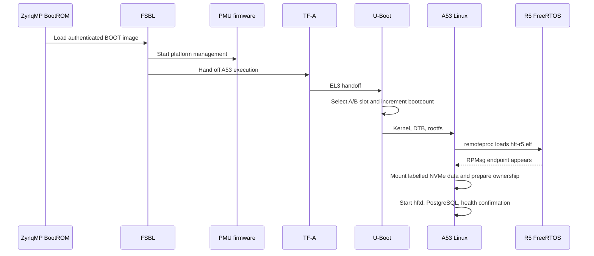
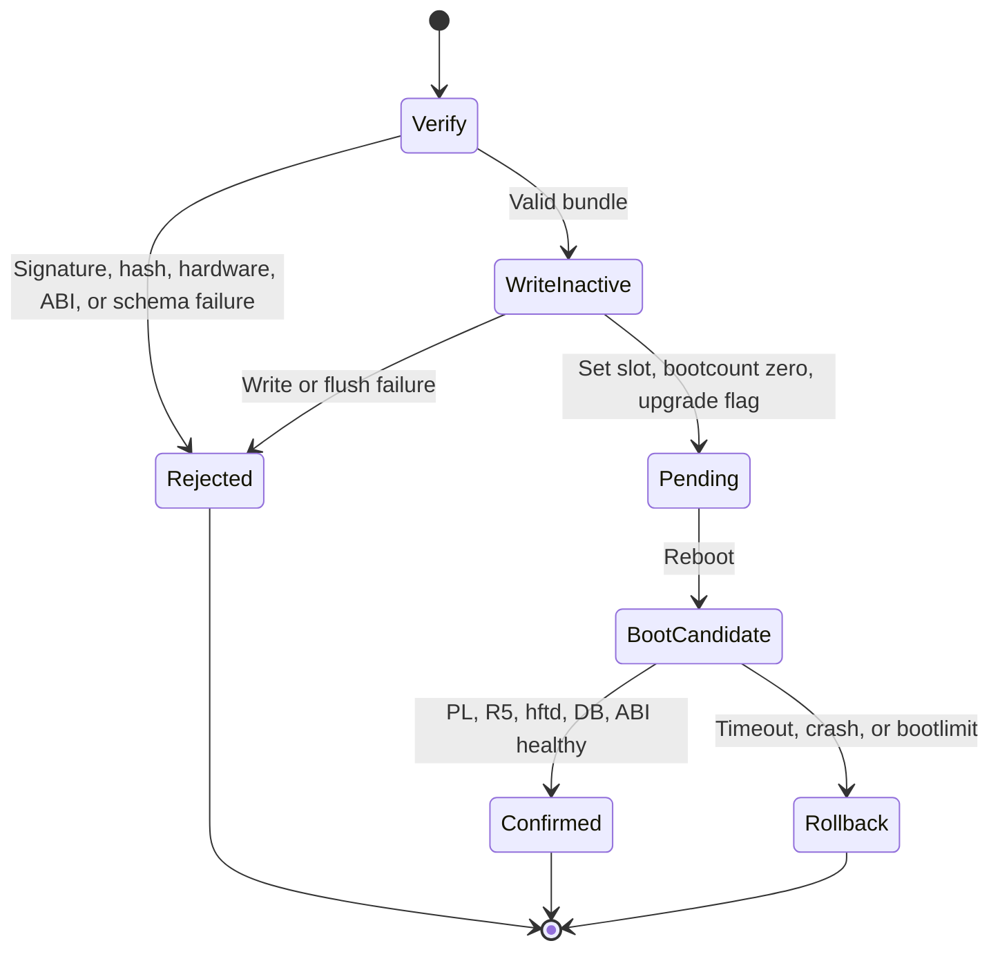

# Boot and update architecture

## Boot chain

### What this repository builds of that chain

The diagram is the intended chain, not what the repository produces. The two
kas targets (`hft-image`, `hft-image-update`) build the Linux side only. U-Boot,
TF-A, the FSBL and the PMU firmware are in neither dependency list (none of the
455 recipes of `bitbake -g hft-image hft-image-update`), so those stages come
from the vendor BOOT image. What that leaves open until a board exists:

- **Slot selection.** The SWUpdate description writes `boot_slot`,
  `upgrade_available`, `bootcount` and `bootlimit`, but nothing in this
  repository or the pinned layers reads `boot_slot` or sets `altbootcmd`.
  The one boot script that is built (`u-boot-xlnx-scr`) uses
  `root=/dev/${bootdev}2`; with the WIC order `boot_a`, `boot_b`, `rootfs_a`,
  `rootfs_b`, partition 2 is `boot_b`, not a root filesystem. A board-specific
  boot script has to pick `rootfs_a` or `rootfs_b` from `boot_slot` and count
  boots.
- **Device tree.** The `device-tree` recipe is skipped (`CONFIG_DTFILE or
  SYSTEM_DTFILE is not defined`), so `IMAGE_BOOT_FILES` is `Image Image
  boot.scr` and the boot partition has no `system.dtb`. The board fragment
  (`hft-myd-czu5ev-v2.dtsi`) is not in today's image.

## Partition layout

The 4 GB eMMC WIC image has 128 MiB `boot_a`/`boot_b` partitions and 1536 MiB
`rootfs_a`/`rootfs_b` partitions, for a 3328 MiB fixed layout. The active root
is read-only where practical.

Persistent PostgreSQL, analytics, and operator configuration live on an NVMe
GPT partition named `hft_data`, mounted at `/data`. Provisioning is a separate,
explicit command requiring both an NVMe device path and `--yes`; boot services
never format media. A missing volume prevents PostgreSQL and `hftd` from
starting but does not modify the SSD or eMMC.

## SWUpdate transaction

A bundle carries the boot-slot image and the rootfs for one slot. CMS/RSA
signatures and SHA-256 hashes are checked before writes, and
`hardware-compatibility` must match; the on-target certificate is installed
from `HFT_SWUPDATE_PUBLIC_CERT`. Private keys remain outside the repository.
Bootloader updates are excluded from routine bundles to preserve recovery.

Planned, not implemented: the rejection on "ABI or schema failure" in the
diagram. `sw-description` has no `scripts` section, no schema field and no
backup step, and no check compares a bundle's ABI with the running one. Today
only the signature, the hashes and the hardware tag can reject a bundle.

## Database compatibility

Migrations are expand-only: each leaves the previous schema usable by the
previous build. `0002_order_events_event_id.sql`, for example, adds a column and
changes the key without breaking an older build's insert, and
`PgRepository::connect` ignores migrations a rolled-back build does not know
(`set_ignore_missing`), so the other slot starts against a newer database.

Planned, not implemented: a backup taken before an update, and a bundle that
declares a schema range and is rejected before installation if the persistent
database is outside it.

## Current verification boundary

CI builds and parses bundle contracts and writes synthetic inactive-slot images.
It does not reboot a MYD-CZU5EV-V2. U-Boot environment persistence, bootcount
rollback, power loss, actual eMMC/NVMe aliases, PCIe link training, FPGA
build-ID health, and remoteproc startup remain pending hardware, as do the
boot-chain gaps listed above.
