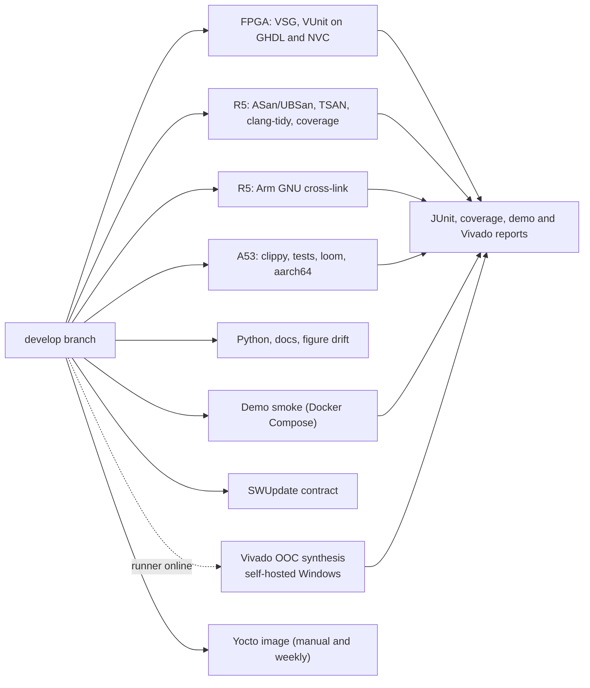

# Build and CI architecture

## Build topology

Every hosted workflow also runs locally, in the same container image, with
`scripts/ci/local.sh` (see [docs/workflow/07-ci.md](../workflow/07-ci.md)).

## Local Windows programmable-logic build

The source belongs at `C:\Users\121679\hft-toy-project`; Vivado belongs at
`C:\AMDDesignTools\2026.1\Vivado`. `verify-tools.ps1` checks the version.
`build-fpga.ps1` invokes one Tcl entry point, places generated state under
`build\vivado\<profile>`, and never opens the hardware manager. The Tcl flow
registers `zynq/ultrascale+/board_files`, targets `xczu5ev-sfvc784-2-e`, reads
the RTL from `rtl/sources.f` (the simulation's list), and fails on negative
setup or hold slack or a Critical CDC finding. `gates.txt` records the
values.

Vivado 2026.1 licenses by tier and exposes only the starting tier's devices.
The free BASIC tier covers the XCZU5EV. If the license file also holds the
ALVEO tier, `split-vivado-license.ps1` writes a BASIC-only copy and
`build-fpga.ps1 -License <dir>` (or `HFT_VIVADO_LICENSE`) selects it.

## Vivado in GitHub Actions

`.github/workflows/vivado.yml` runs the same build on a self-hosted Windows
runner labelled `vivado`. It never runs for pull requests, checks out without
persisted credentials, runs the two profiles one after the other, and uploads
the reports. `scripts/windows/runner.ps1` installs the runner under `C:\ghr`
as the current non-administrator user and starts and stops it on demand.
Until the runner is registered and the repository variable
`HFT_VIVADO_RUNNER` is `online`, the job is skipped instead of queueing.

## C++ build matrix

- Clang 19 debug with ASan/UBSan, and a ThreadSanitizer preset.
- GCC 14 coverage with gcovr HTML/Cobertura.
- Arm GNU 13.3.Rel1 C++23 cross-link with exceptions/RTTI disabled.
- CIB and `fmt` enabled in the target lane.
- A host C++26 reference lane is defined for a GCC 16 environment; target code
  remains C++23.

Clang 19 is the minimum: with libstdc++, `std::expected` needs the
`__cpp_concepts` level Clang 18 does not report. Dependencies are immutable
CMake FetchContent revisions or release archives; the target toolchain archive
is checksum-verified.

## Rust build matrix

Rust 1.97.1/Edition 2024 runs fmt, Clippy (`-D warnings`, which makes
`missing_docs` an error), unit/property tests, mockall actor tests, an
end-to-end daemon test, `loom` model checks, SQL migration validation,
cargo-audit/deny, llvm-cov, and an `aarch64-unknown-linux-gnu` release build.
Cargo.lock is committed.

## Programmable-logic verification

GHDL and the pinned NVC 1.23.0 both run the full VUnit suite; NVC also
collects statement, branch, and functional coverage. VSG checks synthesizable
RTL and testbenches.

## Workflow boundary

Pushes to `develop` trigger the FPGA, R5, A53, quality and demo workflows,
and Vivado when its runner is online. Yocto runs on demand and weekly because
of its resource footprint. No job includes JTAG, a board hostname, hardware
credentials, or remote SWUpdate installation.
