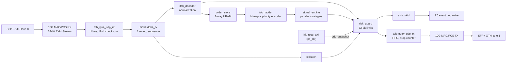
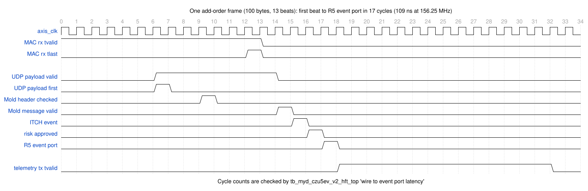
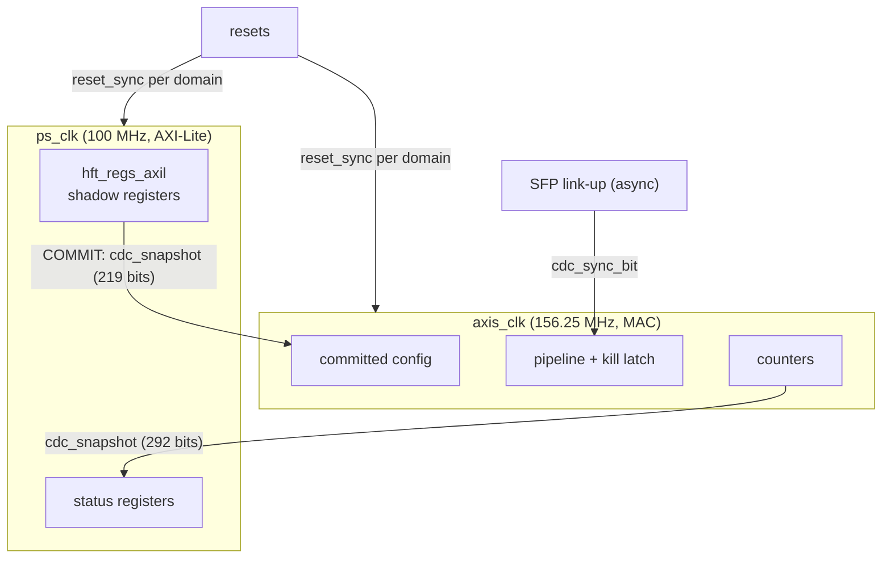

# FPGA architecture

## Pipeline

The programmable-logic (PL) datapath is 64 bits wide at 156.25 MHz, the 10G
MAC user clock, and accepts one beat every cycle. The MAC receive interface
has no `tready`, so no stage may stall: each block either keeps up or fails
closed.

| Block | Latency | What it does |
| --- | --- | --- |
| `eth_ipv4_udp_rx` | 1 cycle | Checks destination MAC/IP/port, Ethernet type, IPv4 version, header checksum (adder tree, four words per beat), fragmentation and lengths, then forwards the UDP payload cut-through with `keep` marking exactly the payload. A MAC error (`tuser` on `tlast`) is a frame fault. |
| `moldudp64_rx` | 1 cycle | Splits MoldUDP64 messages at any byte lane. Every message is at least 12 bytes, so a beat holds at most one boundary; lane roles come from a few small offsets computed in parallel, and message bytes land in ping-pong buffers. Gap and duplicate rules match the software model, and the expected sequence advances only when a packet ends well formed. |
| `itch_decoder` | 1 cycle | Extracts fields at generated offsets (pure wiring) and normalizes `A`/`F` to add, `E`/`C` to execute (with price for `C`), `X`, `D`, `U` (both references) and `P`. The first event after a gap carries `feed_gap`. |
| `order_store` | 2 cycles | Two-way set-associative table of resting orders in UltraRAM (4096 sets). One read-modify-write per event, with one-deep forwarding for back-to-back accesses to a set; replace runs as two micro-ops. A full set is an overflow fault. |
| `tob_ladder` | 6 cycles | Per-side quantity per price level for a 1024-level band above the anchor price, an occupancy bitmap, and a two-stage priority encoder (32 groups of 32) for best bid and best ask. |
| `signal_engine` | 2 cycles | Evaluates every strategy in parallel; the committed `STRATEGY_SELECT` picks one registered result. |
| `risk_guard` | 1 cycle | Adds and PL signals pass only while enabled, not killed, and inside the quantity and price limits; lifecycle events always pass, so the R5 book stays consistent. |
| `telemetry_udp_tx` | 1 cycle + 14 beats | One 106-byte frame per approved event, constant header (checksum computed at elaboration), 16-entry FIFO that drops and counts instead of stalling. |

A 100-byte add-order frame reaches the R5 event port 17 cycles after its
first beat (109 ns), 5 cycles after its last; telemetry starts one cycle
later. `tb_myd_czu5ev_v2_hft_top` checks these numbers.

## Clock and reset domains

Nothing else crosses between the domains, and Vivado's `report_cdc` gate in
`build.tcl` enforces that. Register writes land in `ps_clk` shadow registers;
writing `COMMIT` sends the whole set through one `cdc_snapshot` (a req/ack
toggle handshake whose holding register stays stable until the destination
has captured it), so a 64-bit price collar can never be seen half written.
`CONFIG_REVISION` counts the commits applied. Status crosses back the same
way, reloaded whenever the previous transfer completes, so the counters read
coherently. The holding-register paths are bounded with
`set_max_delay -datapath_only` and `set_bus_skew`
(`constraints/myd_czu5ev_v2_hft_cdc.xdc`). `tb_cdc_snapshot` stresses the
handshake at three clock ratios and checks that no snapshot is torn, lost, or
reordered.

## Kill switch

The kill latch is set out of reset, by the control register's kill bit, and by
any fault: sequence gap, malformed packet or message, book overflow, event
output overflow, link loss, IPv4 header error, or MAC frame error. Faults
dominate: a fault in the same cycle as a clear leaves it set. Clearing takes a
rising edge on the commit-time `clear_faults` pulse while no kill is
requested, and every clear flushes the order book, so trading restarts from a
book built only from post-clear messages.

| Condition | Result |
| --- | --- |
| Wrong MAC/IP/UDP destination | Drop counter; no state change |
| IPv4 checksum, fragment, or length error | Malformed counter, kill latch |
| MAC frame error or link loss | Kill latch |
| Truncated packet or message, bad message length | Malformed counter, kill latch; expected sequence unchanged |
| Sequence gap | Gap counter, kill latch, `feed_gap` on the next event |
| Duplicate packet (A/B line replay) | Parsed, nothing emitted |
| Unknown ITCH type | Unknown counter, skipped |
| Order-store set full | Overflow, kill latch |
| R5 event writer not ready | Overflow, kill latch |
| Telemetry FIFO full | Telemetry drop counter only |
| Kill set | Adds and signals blocked; lifecycle events still reach the R5 |

## Registers

The generated map (`docs/generated/registers.md`) starts at `0xA0000000`.
Writes set enable/kill/clear, quantity and price limits, stock locate,
strategy and the ladder anchor; reads expose build and ABI IDs, status flags
(link up, stale feed, overflow, killed, commit busy), expected sequence,
packet, drop, malformed, gap and telemetry-drop counters, and the applied
revision.

## Vivado

`build.tcl` reads the same source list as the simulation
(`rtl/sources.f`), synthesizes out of context for `xczu5ev-sfvc784-2-e`,
applies the CDC constraints to the synthesized netlist, and fails the build on
negative setup or hold slack or on any Critical CDC finding. Its `impl` goal
then places and routes out of context, with `axis_clk` and `ps_clk` driven
from BUFGCE sites in the middle clock region of the X1 column (`HD.CLK_SRC`),
and fails on negative routed slack or any net with routing errors. Hold from
the input ports is left to the integrated build: out of context their launch
clock is ideal while the capturing registers sit on the BUFGCE tree. The
latest local run:

| Gate | Result |
| --- | --- |
| Setup WNS | +0.906 ns at 6.4 ns |
| Hold WHS | +0.045 ns |
| Critical CDC | 0 (4 recognized synchronizers, 511 constrained handshake bits) |
| Routed setup WNS | +0.296 ns (into the order store's UltraRAM) |
| Routed hold WHS | +0.010 ns |
| Nets with routing errors | 0 |
| Resources | 13.6k LUTs (11.6%), 9.7k FFs (4.1%), 4 URAM, 0 DSP |

Vivado 2026.1 shows only the devices of the license tier it starts with. The
free BASIC tier covers the XCZU5EV; a license file that also holds the ALVEO
tier can start in ALVEO and hide it.
`scripts/linux/split-vivado-license.py` (or
`scripts/windows/split-vivado-license.ps1`) writes a BASIC-only copy, and
`build-fpga.sh --license <dir>` (`build-fpga.ps1 -License <dir>`) or
`HFT_VIVADO_LICENSE` uses it.

The VUnit benches also run on the Vivado simulator (`scripts/linux/xsim.sh`).
xsim 2026.1 compiles VUnit 4.7 but cannot elaborate it, so
`sim/xsim.py` links them against `sim/xsim/vunit_lib.vhd`, a stand-in for the
VUnit calls the benches use, with the compile order and test names from
VUnit and one simulation per test.

`sim-dma` is the license-independent out-of-context build. `sfp10g` also
checks that the AMD 10G/25G subsystem exists. The public MYIR pinout does not
identify the physical SFP cage order or provide a verified ZynqMP DDR/PS
preset, so integrated bitstream/XSA generation deliberately fails. No script
opens the hardware manager or programs a device.
