# IPC and memory map

## Reserved regions

| Region | Base | Size | Owner | Cache policy |
| --- | ---: | ---: | --- | --- |
| R5 ELF/load | `0x3ed00000` | 256 KiB | remoteproc/R5 | no-map |
| RPMsg vring 0 | `0x3ed40000` | 16 KiB | Linux/R5 | no-map |
| RPMsg vring 1 | `0x3ed44000` | 16 KiB | Linux/R5 | no-map |
| RPMsg buffers | `0x3ed48000` | 1 MiB | Linux/R5 | shared DMA |
| PL event ring | `0x3ef00000` | 1 MiB | PL producer/R5 consumer | noncoherent shared |
| PL registers | `0xa0000000` | 64 KiB | PL with PS access | device |

The MYD device-tree fragment exposes the register span as `generic-uio` and
binds the PL ring reserved memory. It is still a provisional executable
contract: addresses and the future PL interrupt must be compared with the
generated XSA/SDT before board use.

## Record layout

`MarketEvent` (PL to R5), `OrderIntent` (R5 to A53) and `RiskConfigRecord`
(A53 to R5) are 64 bytes and aligned to a cache line. The first two bytes are
the ABI version (currently 2). Fields use explicit fixed-width little-endian
integers; no C++, Rust, or VHDL packed record is copied directly from venue
bytes. Generated assertions pin every field offset in C++ (`offsetof`) and
Rust (`offset_of!`), and the VHDL telemetry and replay testbenches encode the
same layout.

```mermaid
flowchart LR
    Abi["Bytes 0-1: ABI"] --> Kind["Byte 2: kind or action"]
    Kind --> Side["Byte 3: side"]
    Side --> Ref["Bytes 4-7: flags or user ref"]
    Ref --> Seq["Bytes 8-15: source sequence"]
    Seq --> Time["Bytes 16-23: timestamp"]
    Time --> Identity["Bytes 24-31: reference or symbol"]
    Identity --> Value["Bytes 32-47: symbol, price, or quantity"]
    Value --> Tail["Bytes 48-63: quantity, revision, reserved"]
```

## Ring protocol

The PL-to-R5 event ring is an LMAX Disruptor ring with one producer (the PL
writer) and several consumers:

1. The producer reads the sequence of the slowest gating consumer with
   acquire semantics. If the next slot is still unread, it applies the
   overflow policy (the PL counts it and latches its kill switch).
2. The producer writes one full record into the slot, word by word.
3. It performs a device/cache barrier where required.
4. It publishes the slot's sequence with release semantics.
5. Each gating consumer (the trading-task stages, in order) observes the
   published sequence with acquire semantics, processes the slot, and
   publishes its own sequence; the next stage gates on the previous one.
6. The lossy journal reader never gates the producer. It copies a slot,
   re-reads the sequence, and discards the copy if the producer has lapped it.

Sequences are 32-bit and compared by wrap-safe distance, because the PL
cannot take part in 64-bit exclusive accesses and aligned 32-bit stores are
single-copy atomic on both sides of the interconnect. Adding a producer is an
architecture change, not a locking exercise.

## ABI negotiation

Build ID, schema digest, ABI version, R5 firmware version, and Linux service
version are reported together. An ABI mismatch prevents arming. Additive fields
consume reserved bytes first; incompatible changes increment the ABI and require
coordinated PL/R5/A53 artifacts in one SWUpdate bundle.
