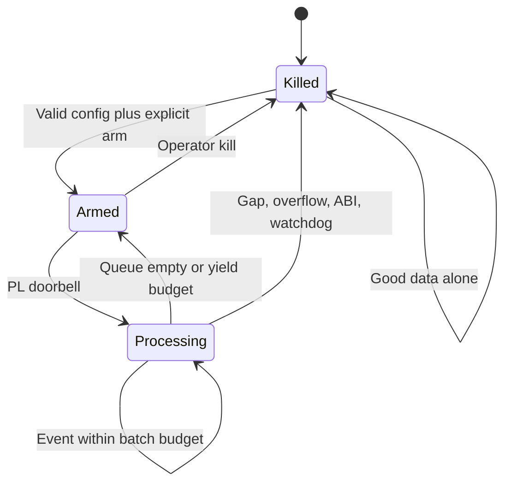
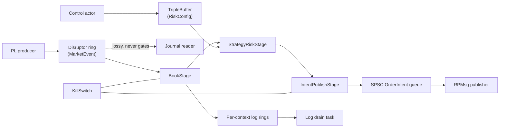

# Cortex-R5 firmware architecture

## Execution contexts

`FirmwareApp` (`hft/app.hpp`) is the composition root: it owns every piece of
firmware state and wires it by reference, with no globals. Each entry point
belongs to exactly one context:

| Context | Entry points |
| --- | --- |
| Producer (PL adapter, ISR, host feeder) | `publish_market_event` |
| Trading task (highest application priority) | `run_trading`, `drain_intents`, `warm_up` |
| Control task | `deliver_config`, `publish_config` |
| Journal task | `poll_journal` |
| Log drain task | `drain_logs` |

The trading task owns market sequence, risk, and order state. Stages run to
completion and cannot block, allocate, or take a mutex; `run_trading` drains
a bounded batch and returns to an explicit yield point. FreeRTOS preemption
remains available for interrupt wakeup and an exceptional watchdog, not for
peer trading tasks.

## Compile-time composition

- The Disruptor pipeline is a Boost.MP11 type list of stages
  (`BookStage`, `StrategyRiskStage`, `IntentPublishStage`); the order is
  fixed at compile time and each stage gates the next.
- The risk rules are another MP11 list folded into one branch-free violation
  mask; `countr_zero` picks the reported rule and per-rule counters advance.
- Strategies are a `std::variant` (`MirrorStrategy`, `ImbalanceStrategy`)
  selected by wire id through `mp_with_index`, with no virtual dispatch.
- Concepts (`hft/concepts.hpp`) constrain clocks, memory policies and
  stages instead of interface base classes.
- Fallible operations return `std::expected`.
- `fmt` formats diagnostics into fixed storage, only when the log drain task
  runs.
- Generated descriptors provide protocol and register constants, and
  `static_assert`s pin every IPC field offset to the schema.
- The control actor is a coroutine whose frame lives in a fixed arena.
  Coroutines are not used in the trading event chain.

## Queue ownership

The ring has 32-bit sequences compared by wrap-safe distance, because the PL
cannot take part in 64-bit exclusive accesses. The producer may reuse a slot
only after the slowest gating stage has passed it; the journal reader never
holds the producer back and detects being lapped instead. Sequences occupy
separate cache lines. Host builds use release/acquire publication; the
PL-shared memory policy adds the AMD barriers and cache maintenance. A full
market ring or intent queue fails closed. Log rings drop and count.

The kill switch is sticky: any context may trip it, and only the control
actor may clear it, with a configuration revision newer than the one in force
when it tripped. A `feed_gap` flag on an incoming event trips it.

## Risk rules

Rules are evaluated together in a fixed order: ABI, trading state, side,
nonzero and maximum quantity, price collar, symbol enable, stock-locate
allowlist, monotonic source sequence, rate window, and open-order cap. Every
violated rule is counted; the first one in that order is reported. An
accepted intent carries the active risk revision. State changes only after
all rules accept.

## Ownership and memory

The runtime graph uses static/value ownership. `std::unique_ptr` appears for
move-only platform resources and the fixed pool returns smart pointers with a
custom deleter. `shared_ptr` is prohibited in the hot path. Exceptions and RTTI
are disabled in the target build. Host tests use ASan/UBSan and GoogleMock
interfaces; GoogleTest is not linked into target firmware.

## FreeRTOS and platform seam

`firmware_main.cpp` exposes weak hooks for the timestamp source, PL event poll,
RPMsg intent publication, and log publication. The AMD BSP build replaces these
hooks and defines `HFT_WITH_XILINX_FREERTOS`. CI also links a freestanding ELF
without the BSP to prove Cortex-R5 code generation. Actual TTC, GIC, OpenAMP,
stack watermark, and interrupt-priority behavior require future hardware tests.
