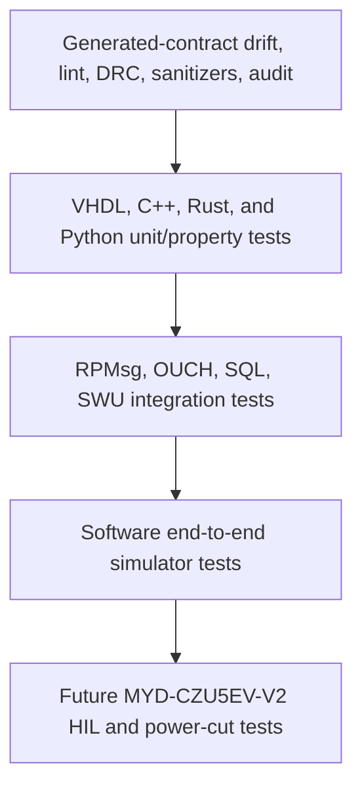
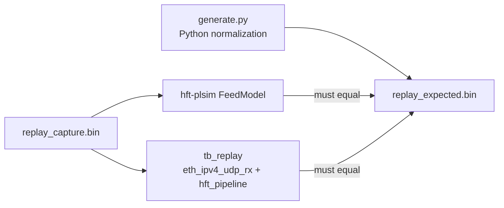

# Verification architecture

## Test pyramid

Hardware tests are specifications only until a board exists; CI stops at the
software end-to-end layer.

## Common vectors

One generated corpus (`protocol/vectors`) is consumed by VHDL, C++, Rust and
Python. It covers valid Add/Cancel, every decoded ITCH type in one packet,
heartbeat, truncation, deterministic session/sequence values, the three
64-byte IPC records, and the 64-byte UDP telemetry record.

The replay session (`replay_capture.bin`, `replay_expected.bin`) is the
three-way equivalence check of the PL ingress: the generator's Python
normalization, the Rust software model (`hft-plsim`), and the RTL
(`tb_replay`) must all produce the same normalized events, byte for byte, for
a session with a duplicate, a truncated packet, a heartbeat and a sequence
gap. The demo repeats the check on its own live capture.

VHDL additionally checks AXI-64 `keep` handling at every byte lane,
Ethernet/IPv4/UDP filtering, IPv4 checksums, malformed headers, the order
book and ladder, the kill latch, the CDC handshake across clock ratios,
end-to-end AXI-Lite configuration, the wire-to-event latency, and telemetry
frame serialization.

## Per-layer checks

- **VHDL:** 52 VUnit test cases on both GHDL and NVC, NVC statement/branch
  coverage, VSG, and Vivado timing and CDC gates locally.
- **C++:** GoogleTest/GoogleMock, typed boundary seams, ASan/UBSan,
  ThreadSanitizer stress tests of the Disruptor, triple buffer and kill
  switch, clang-tidy, gcovr, Cortex-R5 compile/link/map/size checks.
- **Rust:** mockall traits, Tokio paused time, proptest, `loom` model checks of
  the Disruptor, cargo-fuzz target, an end-to-end daemon test, Clippy,
  rustfmt, cargo-audit/deny, llvm-cov, AArch64 link.
- **System:** the Docker Compose demo in smoke mode asserts fail-closed start,
  arming, feed-gap kill, re-arm, operator kill, and the RTL replay match.
- **Python:** pytest, Hypothesis-ready deterministic helpers, Ruff, mypy, and
  coverage for simulator/update/debug tools.
- **Yocto/SWUpdate:** layer parse, image manifest/SBOM, migration execution,
  hash/signature rejection, deterministic newc layout, inactive-slot image
  writes.

## Coverage policy

Generated and vendor code is excluded. Portable R5 handwritten code targets
90% line and branch coverage; target-only BSP hooks require future HIL evidence.
Rust excludes process entrypoints and direct device/PostgreSQL adapters from the
unit threshold but requires integration tests for those boundaries. VHDL
requires all named protocol/risk functional bins even when statement percentage
is already met. Reports are merged under `coverage-reports/index.html`.

## Future HIL scenarios

1. Program the locally generated bitstream without enabling live endpoints.
2. Boot each A/B slot and verify build/ABI IDs.
3. Exercise remoteproc stop/start and R5 watchdog recovery.
4. Replay line-rate and pathological traffic; measure p50/p99/p99.9.
5. Identify the physical SFP cages for GTH lanes 0/1 and verify link resets.
6. Train the PCIe Gen2 x1 NVMe link and verify labelled `/data` failure modes.
7. Add telemetry, database, and update load while measuring scheduler jitter.
8. Interrupt SWUpdate writes and power during each boot stage.
9. Verify bootlimit rollback and persistent database compatibility.
