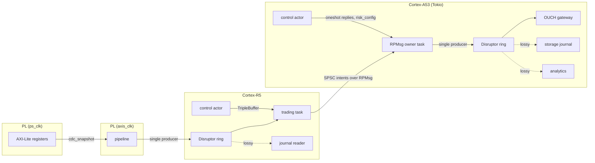

# Concurrency model

Every piece of mutable state has one owner. State that must cross an
execution context does so through one of a few structures, each with a
written ownership and memory-ordering contract in its header. There are no
mutexes on the trading path in any layer.

## PL

The datapath runs in `axis_clk` and has no backpressure upstream of the event
skid buffer. The AXI-Lite register block runs in `ps_clk`. The two meet only
at two `cdc_snapshot` instances (configuration in, status out), two
`cdc_sync_bit` synchronizers (SFP link-up levels), and one `reset_sync` per
domain. A configuration becomes visible atomically when `COMMIT` is written;
partially written limits are never used. `report_cdc` in the Vivado build
fails on any Critical crossing, and `tb_cdc_snapshot` stresses the handshake
across unrelated clocks.

## R5

The PL (or a host feeder) is the single producer of the market-event
Disruptor ring. The trading task runs the compile-time stage pipeline as the
gating consumers; a stage can halt, leaving its event for the next run, which
also holds the producer back. The journal reader is a non-gating consumer
that validates each slot with a sequence stamp and counts what the producer
overwrote. Slots are copied with `std::atomic_ref` word accesses, so a reader
racing a writer sees either the old or the new word, never undefined
behavior. Sequences are 32-bit, padded to their own cache lines, and compared
by wrap-safe distance.

Configuration reaches the trading task through a wait-free `TripleBuffer`:
the control actor publishes a whole `RiskConfig` and the trading task picks
up the newest one at a safe point between batches. Statistics go the other
way through another `TripleBuffer`. The `KillSwitch` keeps its reason mask
and an epoch in one atomic state: every trip bumps the epoch, and a clear is a
compare-exchange against the exact state it inspected, so a trip that races a
clear always wins. Each context logs into its own SPSC ring; one drain task
formats records later, so logging never blocks or allocates on the hot path.

`hft/platform.h` is the C ABI between the firmware and the platform layer
(BSP or host adapter). Each hook documents the single context that may call
it.

## A53

One Tokio task owns the RPMsg endpoint. It is the single producer of a Rust
Disruptor ring (`hft-disruptor`, `forbid(unsafe_code)`): `AtomicU64`-word
slots, padded sequences, gating and stamp-validated lossy consumers, and a
spin-then-`Notify` wait strategy with a cancel-safe waiter guard. The OUCH
gateway is the gating consumer, so no intent is lost; the storage journal
and analytics are lossy consumers, so a slow database can never back up order
flow. `loom` model-checks the publication protocol.

The control state has a single owner, an actor task. Operator requests from
the Unix socket arrive as typed messages with `oneshot` replies; each
accepted change produces a new `risk_config` revision that the RPMsg owner
sends to the R5. The control socket refuses a second daemon on the same path
by connecting before it binds, and each connection runs with a read timeout
and size limit in its own task, so `kill` stays reachable.

## Memory ordering

Publication is release and consumption is acquire everywhere. Device and
non-coherent shared memory additionally need AMD barriers and cache
maintenance, which live in the PL-shared memory policy of the R5 ring and in
the platform adapter. ThreadSanitizer (C++) and `loom` (Rust) cover the host
builds. Actual cacheability and barrier behavior on the MPSoC remain
hardware-verification items.
