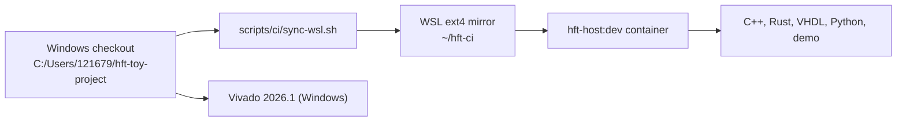

# 01 Setup

Everything except Vivado runs in one container image,
`containers/host/Dockerfile` (tag `hft-host:dev`): Clang 19, GCC 14, the Arm
GNU toolchain, Rust 1.97.1 with the aarch64 target, GHDL, NVC 1.23, VUnit,
VSG, Python 3.12 with the project tools, Node with mermaid-cli, and the
PostgreSQL client. CI, the demo and the local CI script all use it.



## 1. Clone

```powershell
git clone --branch develop git@github.com:ps-chong/hft-toy-project.git `
  C:\Users\121679\hft-toy-project
```

`.gitattributes` stores text with LF endings (PowerShell and batch files keep
CRLF), so the same tree builds on Windows and Linux.
`scripts/windows/normalize-eol.ps1` repairs a tree that picked up CRLF from
Windows editors.

## 2. WSL and Docker

Install WSL with Ubuntu and Docker Engine inside it. Building on `/mnt/c` is
several times slower than on ext4 and sees every file as executable, so work
from a mirror:

```bash
bash /mnt/c/Users/121679/hft-toy-project/scripts/ci/sync-wsl.sh   # -> ~/hft-ci
```

The script rsyncs the checkout (without build outputs and caches), strips
stray CRs, and restores executable bits from Git. Rerun it after every edit
on the Windows side.

## 3. The host image

```bash
cd ~/hft-ci
docker build -t hft-host:dev -f containers/host/Dockerfile containers/host
```

Success: `docker run --rm hft-host:dev clang++ --version` reports Clang 19.

## 4. Vivado (Windows only)

Vivado 2026.1 is expected at `C:\AMDDesignTools\2026.1\Vivado`. It licenses
by tier and exposes only the starting tier's devices: the free BASIC tier
covers the XCZU5EV, the ALVEO tier does not. If the license file holds both,
write a BASIC-only copy once:

```powershell
.\scripts\windows\split-vivado-license.ps1     # -> %APPDATA%\XilinxLicense-BASIC
.\scripts\windows\verify-tools.ps1
```

Success: `build-fpga.ps1 -License "$env:APPDATA\XilinxLicense-BASIC"` logs
"A valid Vivado Design Suite BASIC license has been detected".

## 5. GitHub CLI (optional)

`scripts/windows/poll-ci.ps1` uses `gh` to follow workflow runs; any account
with read access to the repository is enough.
