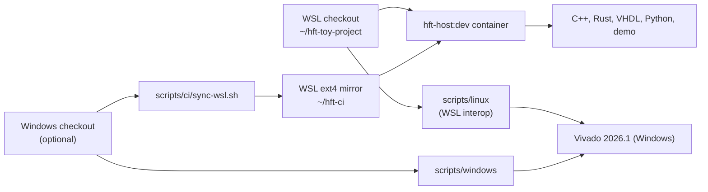

# 01 Setup

Everything except Vivado runs in one container image,
`containers/host/Dockerfile` (tag `hft-host:dev`): Clang 19, GCC 14, the Arm
GNU toolchain, Rust 1.97.1 with the aarch64 target, GHDL, NVC 1.23, VUnit,
VSG, Python 3.12 with the project tools, Node with mermaid-cli, and the
PostgreSQL client. CI, the demo and the local CI script all use it.



## 1. Clone

Clone into the WSL file system (ext4); building on `/mnt/c` is several
times slower and sees every file as executable:

```bash
git clone --branch develop git@github.com:ps-chong/hft-toy-project.git ~/hft-toy-project
```

`.gitattributes` stores text with LF endings (PowerShell and batch files keep
CRLF), so the same tree builds on Windows and Linux.

A Windows checkout still works: `scripts/ci/sync-wsl.sh <checkout>` mirrors
it into `~/hft-ci` (without build outputs and caches), strips stray CRs, and
restores executable bits from Git; rerun it after every edit on the Windows
side. `scripts/windows/normalize-eol.ps1` repairs a Windows tree that picked
up CRLF from Windows editors.

## 2. WSL and Docker

Install WSL with Ubuntu and Docker Engine inside it, and keep WSL interop
enabled (the default) so Linux scripts can start Windows programs.

## 3. The host image

```bash
docker build -t hft-host:dev -f containers/host/Dockerfile containers/host
```

Success: `docker run --rm hft-host:dev clang++ --version` reports Clang 19.

## 4. Vivado (Windows installation)

Vivado 2026.1 is expected at `C:\AMDDesignTools\2026.1\Vivado`
(`/mnt/c/AMDDesignTools/2026.1/Vivado` in WSL; `HFT_VIVADO_ROOT` overrides
it). It licenses by tier and exposes only the starting tier's devices: the
free BASIC tier covers the XCZU5EV, the ALVEO tier does not. If the license
file holds both, write a BASIC-only copy once:

```bash
python3 scripts/linux/split-vivado-license.py  # -> %APPDATA%\XilinxLicense-BASIC
scripts/linux/verify-tools.sh
```

```powershell
.\scripts\windows\split-vivado-license.ps1     # the same, from Windows
.\scripts\windows\verify-tools.ps1
```

The Linux scripts use `%APPDATA%\XilinxLicense-BASIC` when it exists
(`HFT_VIVADO_LICENSE` or `--license` selects another).

Success: `scripts/linux/build-fpga.sh` (or `build-fpga.ps1 -License
"$env:APPDATA\XilinxLicense-BASIC"`) logs "A valid Vivado Design Suite BASIC
license has been detected".

## 5. GitHub CLI (optional)

`scripts/linux/poll-ci.sh` and `scripts/windows/poll-ci.ps1` use `gh` to
follow workflow runs; any account with read access to the repository is
enough.
