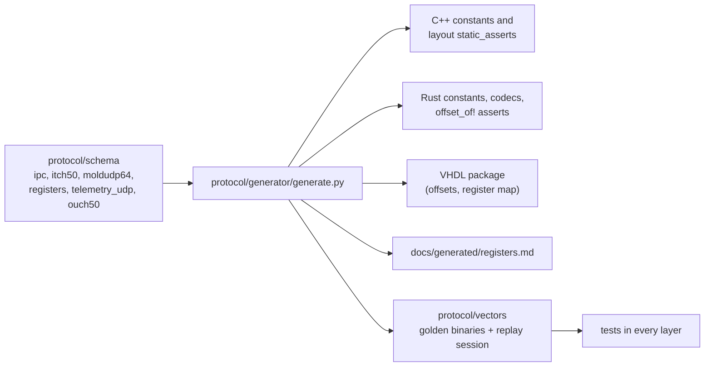

# 02 Contracts

Every byte layout shared by two components is defined once, in
`protocol/schema/*.yaml`, and generated for each language. Nothing is
hand-copied.



## Regenerate and check

```bash
python3 protocol/generator/generate.py          # write outputs
python3 protocol/generator/generate.py --check  # CI: fail if anything is stale
```

The schemas are JSON-compatible YAML, so the generator needs only the
standard library.

## What the outputs guarantee

- **C++:** `hft_protocol_layout.hpp` `static_assert`s `offsetof` and `sizeof`
  of every IPC record against the schema.
- **Rust:** generated `encode_ipc`/`decode_ipc` codecs and `offset_of!`
  assertions for the same records.
- **VHDL:** ITCH field offsets and lengths, MoldUDP64 offsets, event flag
  bits, and the AXI-Lite register map, so decoders index with constants.
- **Vectors:** golden records, MoldUDP64 packets (including every decoded
  ITCH type in one packet and a truncated packet), the telemetry payload, and
  the replay session that the Python normalization, the Rust PL model and
  the RTL must all reproduce.

## Changing a contract

1. Edit the schema; bump `version` (the ABI version) for any layout change.
2. Regenerate, then run `--check`.
3. Update the producers and consumers the compiler now flags (C++ asserts,
   Rust codecs, VHDL constants).
4. Run every layer's tests: the golden vectors catch silent mismatches.
5. Commit the schema, generated files and vectors together.
