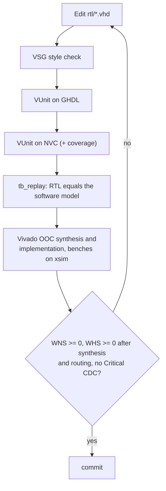

# 03 FPGA

The PL design is VHDL-2008 under `zynq/ultrascale+`: `rtl/` (synthesizable,
listed in compile order in `rtl/sources.f`), `tb/` (VUnit testbenches and
`hft_tb_pkg`), `constraints/`, `sim/run.py`, and `vivado/tcl/build.tcl`. The
architecture is in [docs/architecture/fpga.md](../architecture/fpga.md).



## 1. Style

```bash
vsg -c zynq/ultrascale+/vsg.yaml -f zynq/ultrascale+/rtl/*.vhd zynq/ultrascale+/tb/*.vhd
vsg -c zynq/ultrascale+/vsg.yaml -f <file> --fix     # apply the fixable rules
```

## 2. Simulate

```bash
VUNIT_SIMULATOR=ghdl python3 zynq/ultrascale+/sim/run.py -p 8
VUNIT_SIMULATOR=nvc  python3 zynq/ultrascale+/sim/run.py -p 8
VUNIT_SIMULATOR=nvc HFT_VHDL_COVERAGE=1 python3 zynq/ultrascale+/sim/run.py   # coverage-reports/vhdl
python3 zynq/ultrascale+/sim/run.py "hft.tb_moldudp64_rx.*"                     # one bench
```

Success: `pass 53 of 53` on both simulators (and `53 of 53 tests passed on
xsim` from `scripts/linux/xsim.sh`, below). The benches cover:

| Bench | Checks |
| --- | --- |
| `tb_eth_ipv4_udp_rx` | payload extraction, padding, port filter, checksum error, MAC error |
| `tb_moldudp64_rx` | splitting at all eight lane alignments, duplicates, gaps, heartbeats, truncation, back-to-back packets |
| `tb_itch_decoder` | every ITCH type against the generated replay expectation; length, side and unknown-type errors |
| `tb_order_book` | top of book through adds, executions, cancels, deletes, replaces; same-set forwarding; overflow; flush |
| `tb_signal_engine`, `tb_risk_guard` | strategies and select; limits, kill and enable gating |
| `tb_hft_pipeline` | end to end, fault-dominant kill latch, gap and overflow kills |
| `tb_telemetry_udp_tx` | frame against the generated payload, IPv4 checksum, drop-not-stall |
| `tb_cdc_snapshot` | torn, lost or reordered snapshots at three clock ratios |
| `tb_myd_czu5ev_v2_hft_top` | AXI-Lite commit in `ps_clk`, status readback, link loss, wire-to-event latency |
| `tb_replay` | a datagram capture through the ingress equals the expected events |

`tb_replay` reads any capture: set `HFT_REPLAY_CAPTURE`,
`HFT_REPLAY_EXPECTED` and `HFT_REPLAY_OUTPUT` (the demo does).

The same benches also run on the Vivado simulator, from WSL:

```bash
scripts/linux/xsim.sh                          # build/xsim/xsim-junit.xml and logs/
scripts/linux/xsim.sh --filter tb_risk_guard   # a regex on hft.<bench>[.<config>].<test>
```

xsim 2026.1 cannot elaborate VUnit's own library, so `sim/xsim.py` takes the
compile order and test names from VUnit and links the benches against
`sim/xsim/vunit_lib.vhd`, a stand-in for the VUnit calls they use. Every
test runs in a simulation of its own, as under VUnit. A bench that needs
another VUnit call needs an overload there.

## 3. Synthesize and implement

```bash
scripts/linux/build-fpga.sh --profile sim-dma --goal impl
cat build/vivado/sim-dma/gates.txt
```

```powershell
.\scripts\windows\build-fpga.ps1 -Profile sim-dma -License "$env:APPDATA\XilinxLicense-BASIC"   # synthesis, from Windows
```

Success: the run ends with "out-of-context implementation completed
successfully" ("synthesis" for `--goal synth`), and `gates.txt` shows
non-negative `wns_ns`/`whs_ns` and `route_wns_ns`/`route_whs_ns`,
`critical_cdc=0` and `route_errors=0`. Reports (timing, utilization, clock
interaction, CDC, methodology, DRC, and their `_routed` counterparts with the
route status) are next to it. The clock ports are driven from BUFGCE sites
(`HD.CLK_SRC`) so that out-of-context routing sees real clock trees.

## Adding a block

1. Write the entity with a header comment stating latency, throughput, and
   what happens under backpressure or faults.
2. Add it to `rtl/sources.f` in dependency order (Vivado fails if an RTL file
   is missing from the list).
3. Write a VUnit bench; read vectors through `vector_dir` and register the
   bench in `VECTOR_BENCHES` in `sim/run.py` if it needs them.
4. Any signal that crosses between `ps_clk` and `axis_clk` must go through
   `cdc_snapshot`, `cdc_sync_bit` or `reset_sync`; anything else fails the
   CDC gate.
