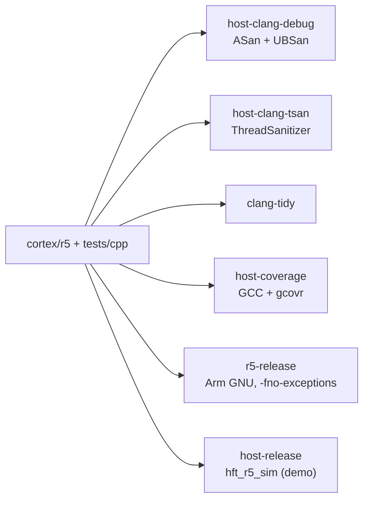

# 04 Cortex-R5

The firmware core is C++23 under `cortex/r5` (headers in
`include/hft`), with GoogleTest suites in `tests/cpp`. The architecture is in
[docs/architecture/r5.md](../architecture/r5.md).



## Build and test

```bash
cmake --preset host-clang-debug && cmake --build --preset host-clang-debug
ctest --preset host-clang-debug
build/host-clang-debug/r5/hft_r5_host_demo

cmake --preset host-clang-tsan && cmake --build --preset host-clang-tsan
ctest --preset host-clang-tsan        # in Docker: --security-opt seccomp=unconfined

run-clang-tidy-19 -quiet -p build/host-clang-debug \
  cortex/r5/src/host_demo.cpp cortex/r5/src/host_platform.cpp
```

ThreadSanitizer re-executes itself with `personality(ADDR_NO_RANDOMIZE)`,
which Docker's default seccomp profile blocks; GitHub runners also need
`sysctl vm.mmap_rnd_bits=28`.

## Coverage

```bash
cmake --preset host-coverage && cmake --build --preset host-coverage
ctest --preset host-coverage
gcovr --root . build/host-coverage --filter cortex/r5/ --filter tests/cpp/ \
  --exclude build/ --gcov-ignore-parse-errors=negative_hits.warn_once_per_file \
  --print-summary
```

The ignore flag covers GCC bug 68080 (negative counts in multi-threaded
tests).

## Cross build

```bash
cmake --preset r5-release && cmake --build --preset r5-release
/opt/arm-gnu-toolchain/bin/arm-none-eabi-size build/r5-release/r5/hft_r5_firmware.elf
```

On the cross build, Boost.Lockfree is used header-only so that Boost.Atomic's
lock pool (which needs pthreads) is never linked.

## The host model

`hft_r5_sim` (preset `host-release`) runs the real firmware core behind the
C ABI in `hft/platform.h`, with Unix sockets standing in for the PL event
ring and RPMsg:

```bash
build/host-release/r5/hft_r5_sim --events /run/hft/events.sock \
  --rpmsg /run/hft/rpmsg.sock --latency-out r5_latency.jsonl --stats-interval-ms 1000
```

It prints one JSON line per event of interest (`r5_ready`, `r5_connected`,
`r5_stats` with event, intent and rejection counters and the kill-reason
mask). It starts killed and stays killed until `hftd` delivers an armed
`risk_config`.
