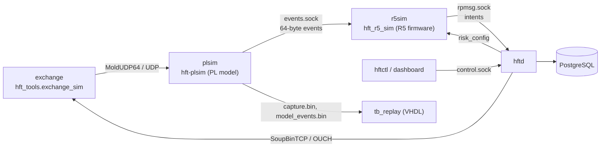

# 06 Demo

The demo runs the whole system on one machine with Docker Compose. Every box
is the project's own code; only the FPGA is replaced, by its software model.



## Run it

```bash
demo/run_demo.sh            # in WSL or Linux, from the repository (or ~/hft-ci)
demo/run_demo.sh --smoke    # shorter, and every step is asserted (CI)
```

```powershell
.\scripts\windows\demo.ps1          # from Windows: syncs to WSL, runs, copies demo/out back
.\scripts\windows\demo.ps1 -Smoke
```

The first run builds `hft-host:dev` and the binaries (a few minutes); later
runs take about a minute.

## What happens

| Step | What you see | What it shows |
| --- | --- | --- |
| 1 Build | `hft_r5_sim`, `hftd`, `hftctl`, `hft-plsim` | the same sources CI tests |
| 2 Start | control socket answering | start-up ordering does not matter (every client retries) |
| 3 Fail-closed start | R5 `events` rising, `intents_sent` = 0 | market data flows, nothing trades until armed |
| 4 Arm | `intents_sent` and `accepted` rising, intent-to-ack p50/p99 | `risk_config` reaches the R5, orders reach the exchange |
| 5 Feed gap (`SIGUSR1` to the exchange) | R5 `kill_reasons` = 32, `intents_received` frozen | the PL model flags `feed_gap`; the R5 kill switch latches |
| 6 Re-arm | `intents_received` rising again | only an operator clear resumes trading |
| 7 Operator kill | `intents_sent` frozen; journal row count | the A53 blocks orders; PostgreSQL has the journal |
| 8 RTL replay | `tb_replay` passes; event count and kinds | the VHDL ingress decodes the captured feed exactly like the model |

A sample run (`--smoke`):

```text
== 3/8 Fail-closed start: market data flows, nothing trades
   R5:   events=250 intents=0 kill_reasons=0
== 4/8 Arm: risk_config goes to the R5, intents flow, the exchange acknowledges
   intents_sent=145 accepted=149 p50=195455 ns p99=435967 ns
== 5/8 Fault: the exchange skips a sequence number (SIGUSR1)
   R5 kill_reasons=32; intents_received 162 -> 162
== 6/8 Re-arm: the operator clears the latched fault
   intents_received 162 -> 307
== 8/8 Replay the captured feed through the VHDL ingress and compare
   ok   tb_replay: RTL events equal the software model's
   1125 events, kinds {'A': 1125}, feed_gap flags 1, match=True
```

## Outputs (`demo/out`)

| File | Content |
| --- | --- |
| `capture.bin` | every datagram the PL model received (u16 length + payload) |
| `model_events.bin` | the PL model's normalized events (64-byte records) |
| `rtl_events.bin` | the same, decoded by the VHDL |
| `replay_summary.json` | comparison summary (`hft_tools.replay_compare`) |
| `r5_latency.jsonl`, `latency.html` | R5 tick-to-intent samples and report |

## Poke at it

While the stack runs (`docker compose -f containers/compose.yml -p hft-demo
--profile demo up -d`):

```bash
docker compose -f containers/compose.yml -p hft-demo --profile demo exec hftd \
  target/release/hftctl --socket /run/hft/control.sock status
docker compose -f containers/compose.yml -p hft-demo --profile demo kill -s SIGUSR2 exchange  # malformed packet
docker compose -f containers/compose.yml -p hft-demo --profile dashboard run --rm dashboard
```

Set `HFT_DEMO_INTERVAL` (seconds between feed packets, default 0.02) before
`up` to change the feed rate.
