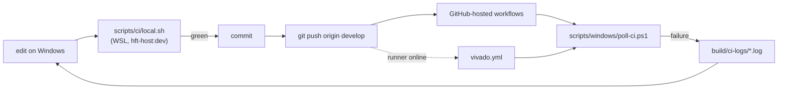

# 07 CI

## Workflows

| Workflow | Runs on | Does |
| --- | --- | --- |
| `fpga.yml` | GitHub-hosted | generated-contract check, VSG, VUnit on GHDL, VUnit on NVC with coverage |
| `r5.yml` | GitHub-hosted | ASan/UBSan tests, host demo, clang-tidy, TSAN, GCC coverage; Arm cross-link |
| `a53.yml` | GitHub-hosted | fmt, clippy, tests with PostgreSQL, `loom`, migrations, coverage, audit/deny, aarch64 build |
| `quality.yml` | GitHub-hosted | Ruff, mypy, pytest with coverage, diagram and figure drift |
| `demo.yml` | GitHub-hosted | the Compose demo in smoke mode, `demo/out` as an artifact |
| `swupdate.yml` | GitHub-hosted | deterministic signed contract bundle |
| `vivado.yml` | self-hosted Windows | OOC synthesis of both profiles with the timing and CDC gates |
| `yocto.yml` | GitHub-hosted, manual and weekly | kas parse and image build |

All run on pushes to `develop` and pull requests against it, except
`vivado.yml` (pushes to `develop` touching RTL, constraints or Tcl, and manual
dispatch; never pull requests) and `yocto.yml`.



## Run CI locally

```bash
bash /mnt/c/Users/121679/hft-toy-project/scripts/ci/sync-wsl.sh
cd ~/hft-ci
scripts/ci/local.sh all                     # r5 a53 fpga quality swupdate demo
scripts/ci/local.sh fpga quality            # any subset
HFT_CI_DEPENDENCY_POLICY=1 scripts/ci/local.sh a53   # also cargo audit / deny
```

Each job runs in `hft-host:dev` exactly as its workflow does; the A53 job
starts its own PostgreSQL container.

## Push and follow the runs

```powershell
git push origin develop
.\scripts\windows\poll-ci.ps1               # waits for every run of HEAD
```

`poll-ci.ps1` prints each workflow's conclusion and saves the failed-step
logs of failed runs under `build\ci-logs`. It exits 1 if anything failed.

## The Vivado runner

`vivado.yml` needs a self-hosted runner with the labels `windows` and
`vivado` on the workstation that has Vivado:

```powershell
.\scripts\windows\runner.ps1 -Action Install -Token <registration token>
.\scripts\windows\runner.ps1 -Action Start      # before a CI cycle
.\scripts\windows\runner.ps1 -Action Stop       # after it
```

The registration token comes from Settings > Actions > Runners > New
self-hosted runner, or the script requests one itself when the GitHub CLI
token has Administration read/write on the repository. The runner lives in
`C:\ghr`, runs as the current user, and its `.env` puts Git on `PATH` and
points `HFT_VIVADO_LICENSE` at the BASIC-tier license. Then set the
repository variable `HFT_VIVADO_RUNNER` to `online`; until then the job is
skipped rather than left queued. Without a runner, run the same gates with
`build-fpga.ps1` locally.
