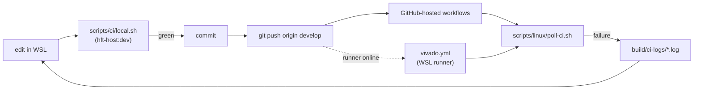

# 07 CI

## Workflows

| Workflow | Runs on | Does |
| --- | --- | --- |
| `fpga.yml` | GitHub-hosted | generated-contract check, VSG, VUnit on GHDL, VUnit on NVC with coverage |
| `r5.yml` | GitHub-hosted | ASan/UBSan tests, host demo, clang-tidy, TSAN, GCC coverage; Arm cross-link |
| `a53.yml` | GitHub-hosted | fmt, clippy, tests with PostgreSQL, `loom`, migrations, coverage, audit/deny, aarch64 build |
| `quality.yml` | GitHub-hosted | Ruff, mypy, pytest with coverage, diagram and figure drift |
| `demo.yml` | GitHub-hosted | the Compose demo in smoke mode, `demo/out` as an artifact |
| `swupdate.yml` | GitHub-hosted | deterministic signed contract bundle |
| `vivado.yml` | self-hosted, WSL | OOC synthesis and implementation of both profiles with the timing, routing and CDC gates; the VUnit benches on xsim |
| `yocto.yml` | GitHub-hosted, manual and weekly | kas parse and image build |

All run on pushes to `develop` and pull requests against it, except
`vivado.yml` (pushes to `develop` touching RTL, benches, constraints, Tcl or
`scripts/linux`, and manual dispatch; never pull requests) and `yocto.yml`.



## Run CI locally

From the WSL checkout:

```bash
scripts/ci/local.sh all                     # r5 a53 fpga quality swupdate demo
scripts/ci/local.sh fpga quality            # any subset
HFT_CI_DEPENDENCY_POLICY=1 scripts/ci/local.sh a53   # also cargo audit / deny
scripts/linux/build-fpga.sh --profile sim-dma --goal impl   # vivado.yml, one profile
scripts/linux/xsim.sh                       # vivado.yml, the xsim job
```

Each job runs in `hft-host:dev` exactly as its workflow does; the A53 job
starts its own PostgreSQL container. From a Windows checkout, run
`bash scripts/ci/sync-wsl.sh <checkout>` in WSL first and work in `~/hft-ci`.

## Push and follow the runs

```bash
git push origin develop
scripts/linux/poll-ci.sh                    # waits for every run of HEAD
```

```powershell
.\scripts\windows\poll-ci.ps1               # the same, from Windows
```

`poll-ci.sh` (and `poll-ci.ps1`) print each workflow's conclusion and save
the failed-step logs of failed runs under `build/ci-logs`. They exit 1 if
anything failed.

## The Vivado runner

`vivado.yml` needs a self-hosted runner with the labels `linux` and
`vivado`, in WSL on the workstation that has Vivado:

```bash
scripts/linux/runner.sh install --gh "/mnt/c/Program Files/GitHub CLI/gh.exe"
scripts/linux/runner.sh start                # before a CI cycle
scripts/linux/runner.sh stop                 # after it
scripts/linux/runner.sh status
```

`install` takes `--token <registration token>` from Settings > Actions >
Runners > New self-hosted runner, or requests one itself through `gh` when
its token has Administration read/write on the repository (`--gh` picks the
CLI; here the Windows one, logged in as the repository owner). The runner
lives in `~/ghr`, runs as the current user in a session of its own, and its
`.env` points `HFT_VIVADO_ROOT` and `HFT_VIVADO_LICENSE` at the Windows
Vivado and the BASIC-tier license. It stops when WSL shuts down, so keep a
WSL session open while it should take jobs. Then set the repository variable
`HFT_VIVADO_RUNNER` to `online`; until then the jobs are skipped rather than
left queued. Without a runner, run the same gates locally with
`scripts/linux/build-fpga.sh` and `xsim.sh`.

`scripts/windows/runner.ps1` still registers a native Windows runner (labels
`windows`, `vivado`) for a Windows checkout, but `vivado.yml` requests the
`linux` label.
