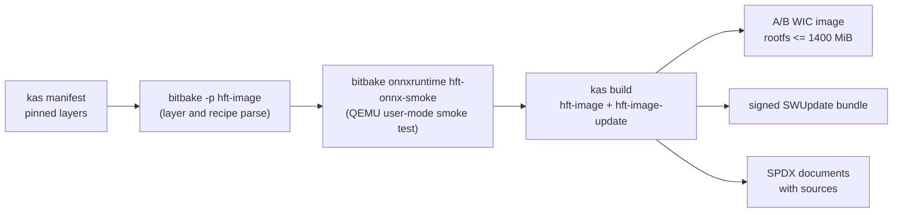

# 08 Yocto and release

The A53 Linux image is built with kas from `yocto/kas/myd-czu5ev-v2.yml`
(Scarthgap, AMD 2026.1 layers pinned by commit) plus this repository's
`meta-hft` layer. See [yocto/README.md](../../yocto/README.md) for the layer
details.



## Build locally

`yocto.yml` runs on demand and weekly on GitHub. The same steps run locally
in the Yocto container (tens of gigabytes of disk and several hours for the
first full build; `yocto/downloads` and `yocto/sstate-cache` make later
builds incremental):

```bash
cd ~/hft-ci
docker build -t hft-yocto -f containers/yocto/Dockerfile .
docker run --rm -v "$PWD:/workspace" hft-yocto \
  kas shell yocto/kas/myd-czu5ev-v2.yml -c 'bitbake-layers show-layers && bitbake -p hft-image'
docker run --rm -v "$PWD:/workspace" hft-yocto \
  kas shell yocto/kas/myd-czu5ev-v2.yml -c 'bitbake onnxruntime hft-onnx-smoke'
docker run --rm -v "$PWD:/workspace" hft-yocto kas build yocto/kas/myd-czu5ev-v2.yml
```

Outputs land in `yocto/build/tmp/deploy/images/hft-myd-czu5ev-v2/` (`*.wic*`,
`*.swu`) and `yocto/build/tmp/deploy/spdx/`.

The image recipes fetch the project's own sources from GitHub at
`HFT_SRCREV` (default: the tip of `develop`), so push before building, and
pin `HFT_SRCREV` to a commit for anything you intend to keep.

## ONNX Runtime

`HFT_ENABLE_ONNX = "1"` (the default) adds ONNX Runtime 1.20.1 with the CPU
execution provider, its Python bindings, and `hft-onnx-smoke`. The smoke test
runs at build time under QEMU user mode and on the target as
`/usr/bin/hft-onnx-smoke`. ONNX serves noncritical analytics only
([docs/acceleration.md](../acceleration.md)).

## SWUpdate bundles

`swupdate.yml` (and `scripts/ci/local.sh swupdate`) builds a deterministic,
signed contract bundle from stand-in images, which checks the
`sw-description`, the newc layout, and signature handling without a Yocto
build:

```bash
python deploy/swupdate/build_bundle.py --description deploy/swupdate/sw-description \
  --rootfs rootfs.ext4.gz --boot boot.vfat --key key.pem --certificate cert.pem \
  --output hft.swu
```

Release signing keys are external; see
[deploy/swupdate/keys/README.md](../../deploy/swupdate/keys/README.md).

## What is not done

No workflow flashes a board or installs an update remotely. The generic
machine stays non-deployable until a verified MYIR PS/DDR preset and the
physical SFP cage mapping are available, and until the R5 node labels and PL
address map are checked against the XSA/SDT exported by Vivado.
