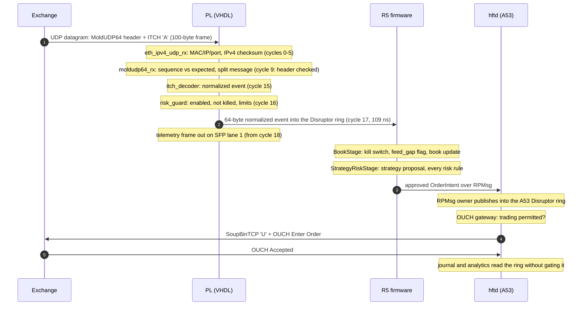

# 09 Life of a packet

One ITCH add order, from the wire to the exchange acknowledgement, with what
each layer checks and how long it takes. Cycle counts are at the 156.25 MHz
`axis_clk` and are checked by `tb_myd_czu5ev_v2_hft_top`.

## In the PL

| Cycle | Block | What happens |
| --- | --- | --- |
| 0-12 | MAC | 13 beats of 8 bytes; the frame-start cycle counter is latched as the ingress timestamp |
| 1-5 | `eth_ipv4_udp_rx` | headers checked as their lanes arrive; IPv4 checksum summed four words per beat; verdict in beat 5 |
| 6-13 | `eth_ipv4_udp_rx` | UDP payload forwarded cut-through, `keep` marking only payload bytes |
| 9 | `moldudp64_rx` | header evaluated one cycle after it completes: duplicate, gap, or in order |
| 14 | `moldudp64_rx` | message complete in its ping-pong buffer |
| 15 | `itch_decoder` | fields extracted at generated offsets; kind normalized |
| 16 | `risk_guard` | an add passes only while enabled, not killed, and inside the limits |
| 17 | event port | the event leaves through the skid buffer to the R5 ring writer |
| 18-31 | `telemetry_udp_tx` | the 106-byte telemetry frame, without ever stalling the event path |

In parallel the event updates the order store and the top-of-book ladder;
six cycles later the signal engine sees the new best bid and ask.

If anything is wrong the packet never becomes a trade:

- a filter miss is dropped and counted;
- a checksum, length or framing error, or a sequence gap, sets the kill
  latch, which blocks adds and signals until an operator commit clears it;
- a gap also sets `feed_gap` on the next event, so the R5 latches its own kill
  even when it is fed by the software model.

## In the R5

The event is one slot of the Disruptor ring. The trading task runs the stages
in their compile-time order:

1. `BookStage` trips the sticky kill switch if the event carries `feed_gap`,
   then validates ABI and sequence and applies lifecycle events; an add
   becomes an entry candidate.
2. `StrategyRiskStage` asks the active strategy for a proposal and runs every
   risk rule in one branch-free pass; the first violated rule is reported and
   the approved intent carries the active risk revision.
3. `IntentPublishStage` re-checks the kill switch (another context may have
   tripped it during the batch) and pushes the intent into the outbound
   queue; a full queue halts the pipeline and trips the kill switch.

On the host model the median from event intake to intent publication is
18 us (p99 60 us), measured in the demo; the number on the board needs the
hardware.

## In the A53

The RPMsg owner task reads the intent and publishes it into the A53
Disruptor ring. The OUCH gateway, the only gating consumer, sends it if the
operator state permits trading (armed, not killed); otherwise it is counted as
blocked. The exchange's acknowledgement closes the intent-to-ack measurement
(195 us median in the demo, through Docker networking). The journal and
analytics consumers read the same ring without being able to slow it down.

## Where to look

| Question | Tool |
| --- | --- |
| Did the PL see the packet? | `PACKET_COUNT`, `DROP_COUNT`, `MALFORMED_COUNT`, `GAP_COUNT` registers (`hft-regdump`) |
| Why is the PL killed? | `STATUS` flags; telemetry `status_flags` |
| Did the R5 trade? | `r5_stats` (events, intents, rejected, `kill_reasons`) |
| Did the A53 send it? | `hftctl counters` (`intents_received`, `intents_sent`, `intents_blocked`) |
| Was it journaled? | `order_events` in PostgreSQL |
