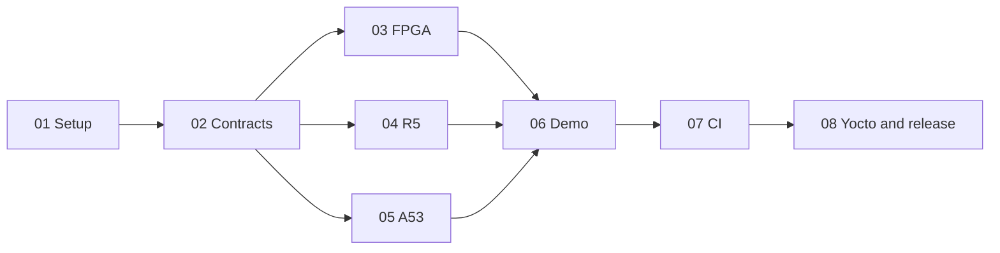

# Workflow guides

Step-by-step guides for working on the project, in the order a new developer
usually needs them. Each one lists the exact commands and what success looks
like.

| Guide | Covers |
| --- | --- |
| [01 Setup](01-setup.md) | Tools, the WSL mirror, the host image, Vivado and its license tier |
| [02 Contracts](02-contracts.md) | Schemas, the generator, and changing a field safely |
| [03 FPGA](03-fpga.md) | RTL, simulation on GHDL and NVC, VSG, Vivado gates |
| [04 Cortex-R5](04-r5.md) | Presets, sanitizers, coverage, the cross build, the host model |
| [05 Cortex-A53](05-a53.md) | Rust workspace, PostgreSQL tests, `loom`, the daemon and `hftctl` |
| [06 Demo](06-demo.md) | The Docker Compose demo and its fault-injection narrative |
| [07 CI](07-ci.md) | GitHub workflows, running them locally, pushing and polling |
| [08 Yocto and release](08-yocto-release.md) | Image build, ONNX Runtime, SWUpdate bundles |
| [09 Life of a packet](09-packet-walkthrough.md) | One add order from the wire to the exchange acknowledgement |

